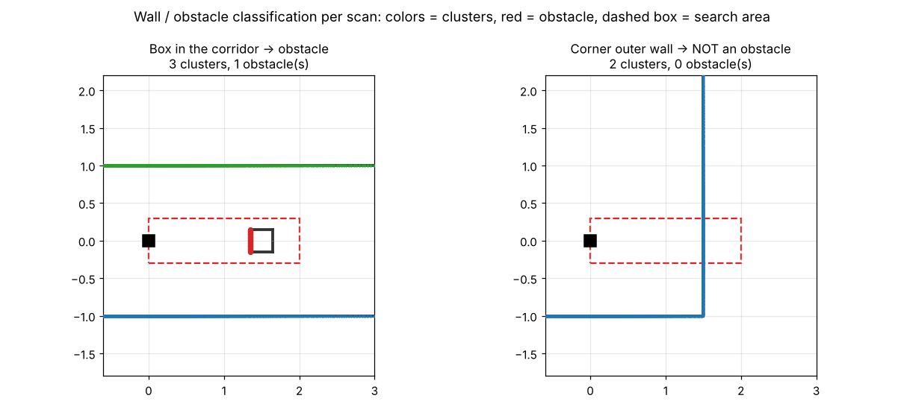
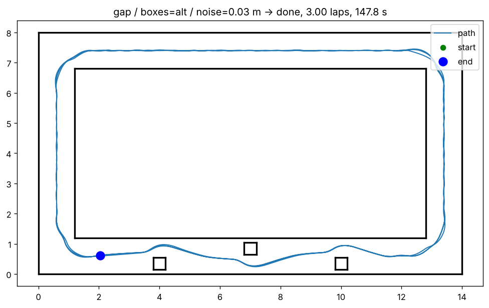

# RoboRacer LiDAR Planning — Gap Follow · Wall/Obstacle Clustering · Wall Follow

**2026 Automotive Engineering Lab, Team 2** project:
a 1/10-scale autonomous race car (RoboRacer / F1TENTH-style) that drives a closed-loop track **without a map**, reacting to each sensor frame.

- **Follow the Gap** with a disparity extender, for sections with obstacles
- **Wall / obstacle classification** by clustering each scan, used to switch modes
- **Wall following** (centre of two walls, PID), for the pipe-shaped sections

> The full team stack (ROS 2 Humble nodes, camera lane following, motor control, mode manager) lives in a private team repository.
> This repository contains only the LiDAR planning part assigned to me, as plain Python with no ROS dependency.

## Results


**Follow the Gap.** The scan is cleaned, the closest obstacle is wiped with a safety bubble, and every edge is widened by the car's half width so that gaps the car cannot fit through disappear. The car aims at the deepest point near the centre of the largest remaining gap. In the middle panel, the 0.25 m slit between the box and the wall is rejected and the car passes on the open side.



**Wall vs. obstacle.** Each scan is split into clusters of consecutive points with an adaptive breakpoint threshold. A cluster is an obstacle only if it is **short** and lies **inside the forward corridor**. The length check is what stops the outer wall of a corner from being mistaken for an obstacle (right panel).

**Tests.** All 117 tests pass (`python -m pytest`: 17 passed, 100 xpassed, 0 failed).
The two speed-selection functions (`speed_from_front`, `speed_from_steer`) belong to a teammate (hardware/control); this repository carries **temporary** implementations, marked `TODO`, so the controllers can be driven end to end until the teammate's version replaces them.



**Closed-loop check without ROS.** `sim/offline_sim.py` drives the controllers on a 1.2 m pipe-like loop with boxes, using a kinematic bicycle model and the same 0.24° / 20 Hz beam layout as the YDLIDAR TEA. Gap follow completes 3 laps with 3 cm range noise. This is a quick sanity check only; f1sim_ms and the real car are still required.

| Scenario (`--boxes`) | gap | wall |
|---|---|---|
| `none` (empty loop) | 3 laps, 44 s/lap | 3 laps, 42 s/lap |
| `alt` (3 boxes, alternating sides) | 3 laps, 49 s/lap (also with 3 cm noise) | 3 laps (boxes are passed by luck: wall follow has no avoidance; on the car the mode manager switches to GAP) |
| `wall` (box touching the wall) | 3 laps | 3 laps |
| `row` (2 boxes 1 m apart, opposite sides) | **crash** | crash |

The `row` case is a geometry limit, not a code bug: with wheelbase 0.25 m and `max_steer_deg` 20°, the minimum turning radius is about 0.69 m, too large for a 0.5 m sidestep within 1 m in a 1.2 m corridor. It passes with 30° steering or a 1.6 m corridor. The real maximum steering angle and box spacing need to be measured.

**Latency study (f1sim_ms).** The 11/24 bags show a 0.2–0.3 s lag between a command and the wheels. `sim/sim_eval.py` runs the controllers headless on the f1sim_ms C++ core with that lag, 3 cm range noise and the same output limits as `mode_manager` (steer rate, acceleration, 0.3–1.5 m/s). The car is the f1sim_ms default, which matches the RoboRacer chassis (wheelbase 0.33 m, 0.58 × 0.31 m, 24° steering), with the LiDAR 0.275 m ahead of the rear axle as in the f1sim_ms ROS bridge. Maps are the team's three box layouts plus an empty loop, baked with the f1sim_ms obstacle generator (`sim/make_obstacle_maps.py`). Corridor 1.5 m, 3 laps:

| Setting | lag 0 | 0.2 s | 0.25 s | 0.3 s |
|---|---|---|---|---|
| gap, defaults (1.0 m/s, half_width 0.2) | 6/8, 43 s/lap | 1/8 | 0/8 | 0/8 |
| gap, 0.7 m/s + steer rate 180°/s | 8/8, 56 s | 7/8 | 6/8 | 5/8 |
| gap, **0.7 m/s + steer rate 180°/s + half_width 0.35** | 8/8, 55 s | 8/8, 60 s | 8/8, 62 s | 7/8, 64 s |
| wall, defaults (1.0/0.7/0.4 m/s, corner_front_dist 2.0 m) | 4/4, 43 s | 4/4 | 4/4 | 4/4 |

What helps gap follow, in order:
1. **Lower speed.** The car drives blind for the length of the lag (25 cm at 1.0 m/s, 0.25 s).
2. **Widen the disparity margin** (`half_width` 0.2 → 0.35). With the LiDAR ahead of the rear axle the car turns as soon as its nose clears a corner, and the rear clips the inner corner. The cost: gaps narrower than 0.7 m are treated as blocked; set it again once the real car and box spacing are measured.
3. **Raise the steer-rate limit** in `mode_manager` (`max_steer_rate_deg`, owned by the team lead) from 90 to 180°/s. At 90°/s a 20° turn takes another 0.22 s, which acts like extra lag.

Wall follow is fine with the defaults at every lag tested. An earlier version of this study (LiDAR placed over the rear axle) suggested a larger `corner_front_dist`; with the LiDAR in front that makes the car cut corners, so it is withdrawn. The LiDAR position matters: pass the measured value with `--lidar-x`. Tuned values are in `config/delay_tuned.yaml`. Without lag (simulator only), half_width 0.35 also allows `max_speed` 1.5 m/s (33 s/lap, 12/12 runs).

**Pure Pursuit steering for gap follow (option, 2026-11-28).** Gap follow normally uses the target angle directly as the steering angle. With `steer_mode: pursuit` the target is moved from the LiDAR to the rear axle (`lidar_x`) and converted with the pure pursuit law δ = atan(2·L·y / (x² + y²)), with the lookahead capped at `pursuit_max_dist`. Same setup as above (corridor 1.5 m, 0.7 m/s, half_width 0.35, 3 cm noise), five maps including a box in the middle of the corridor, 2 laps, no steady-state steer-rate limit (the team `mode_manager` limits it only for 0.5 s after a mode change):

| Steering | lag 0 | 0.2 s | 0.25 s | 0.3 s |
|---|---|---|---|---|
| target angle (current) | 5/5, wobble 7.0° | 5/5, 3.5° | 3/5 | 3/5 |
| pure pursuit, cap 1.5 m | 4/5 | – | 4/5 | – |
| pure pursuit, cap 1.2 m | 4/5 | – | 4/5 | – |
| **pure pursuit, cap 1.0 m** | 5/5, 3.5° | 5/5, 2.5° | 5/5, 2.1° | 5/5, 1.9° |

Wobble is the mean change of the steering command per control step. Pure pursuit halves it and keeps 0.1–0.15 m more clearance from walls and boxes. A longer cap steers too gently to dodge the centre box; 1.0 m passes every map at every lag. Values are in `config/pursuit.yaml`. The old behaviour is the default, so the team `safe.yaml` works unchanged. Background and paper notes are in [docs/planner_research.md](docs/planner_research.md).

**Corridor width and LiDAR position matter.** At 1.2 m, the f1sim_ms car (0.58 × 0.31 m) hits the corners even with no lag; at 1.5 m it does not. The real corridor width, the car's minimum turning radius and the LiDAR position (rear axle → LiDAR, LiDAR → front bumper) must be measured before final tuning.

## Pipeline

```
/scan ─ normalize ─┬─ cluster_scan ─ find_obstacles ──────────────► mode switch (WALL ↔ GAP)
                   ├─ wall_distance ×2 ─ center_error ─ PID ───────► steering (wall follow)
                   └─ preprocess ─ safety_bubble ─ disparity_extend
                        ─ find_max_gap ─ best_point ───────────────► steering (gap follow)
```

Convention: REP-103 (x forward, y left, angle 0 straight ahead, counter-clockwise positive). Scan angles are measured at the LiDAR; `base_link` is the rear-axle centre on the ground, and the LiDAR sits about 0.27 m ahead of it (team `mount.yaml`, to be measured).

## What I implemented

| File | Function | Idea |
|---|---|---|
| `src/control/control/core/gap.py` | `preprocess` | Interpolate invalid beams (NaN/inf/≤0) from neighbours instead of treating them as obstacles, clip to max range, edge-padded moving average |
| | `safety_bubble` | Zero every beam within ±asin(R / r) of the closest point (±90° if r ≤ R) |
| | `disparity_extend` | At each range jump, copy the near distance d over the far side for atan(half_width / d); edges detected on the input, written to a copy |
| | `find_max_gap` | Longest run of free beams (ties keep the first) |
| | `best_point` | Among beams ≥ 0.9 × deepest, pick the one closest to the gap centre |
| | `pure_pursuit_steer` | Optional: move the target to the rear axle and steer along the circular arc through it, lookahead capped |
| `src/control/control/core/wall.py` | `wall_distance` | F1TENTH Lab 3 geometry: α = atan2(a·cosθ − b, a·sinθ), D = b·cosα + L·sinα; median over a small angular window to survive dropouts; reject far beams before the trigonometry (corner case) |
| | `center_error` | Error to the corridor centre, continuous when one wall disappears |
| | `PID` | Discrete PID with integral anti-windup and safe handling of dt ≤ 0 |
| `src/perception/perception/core/scan_utils.py` | `cluster_scan` | Adaptive breakpoint: split when the gap between consecutive valid points exceeds `break_dist + break_ratio × r` |
| | `find_obstacles` | Short cluster (≤ max length) with a point inside the forward corridor |

## Run it

```bash
pip install -r requirements.txt
python -m pytest                              # contract tests
python demo.py                                # regenerates the figures in docs/
python sim/offline_sim.py gap                 # closed loop, no ROS (Windows/macOS/Ubuntu)
python sim/offline_sim.py wall --boxes none --plot docs/offline_wall.png
```

With Ubuntu 22.04 and [f1sim_ms](https://github.com/leemyungsub324/f1sim_ms) installed (team TODO 4-0):

```bash
python3 sim/make_pipe_map.py maps/pipe --width 1.2   # then place boxes with f1sim_ms/tools/obstacle_map_maker.py
python3 sim/sim_check.py gap --render --map maps/pipe_obs
```

Headless latency check on the f1sim_ms C++ core (no window, no ROS):

```bash
python3 sim/make_pipe_map.py maps/pipe --width 1.5
python3 sim/make_obstacle_maps.py maps/pipe.yaml --maker ~/f1sim_ms/tools/obstacle_map_maker.py
export PYTHONPATH=~/f1sim_ms/gym
python3 sim/sim_eval.py gap maps/pipe_obs_*.yaml --delay 0.25 --steer-rate 180 \
    --params config/params.yaml config/delay_tuned.yaml
python3 sim/sim_eval.py gap maps/pipe_obs_*.yaml --delay 0.25 --steer-rate 1000 \
    --params config/params.yaml config/delay_tuned.yaml config/pursuit.yaml   # pure pursuit option
python3 sim/sim_eval.py wall maps/pipe.yaml --delay 0.25 \
    --params config/params.yaml config/delay_tuned.yaml \
    --set wall_follow.half_width=0.75 --set wall_follow.max_wall_dist=1.8
```

Parameters come from `config/params.yaml`, a copy of the team `safe.yaml` (`gap_follow`, `wall_follow`). Pass `--params <team repo>/src/bringup/config/safe.yaml` to use the team file directly.

## Status and next steps

- [x] Gap follow — unit tests pass
- [x] Wall / obstacle clustering — unit tests pass
- [x] Wall follow — unit tests pass
- [x] Closed-loop sanity check without ROS (`sim/offline_sim.py`)
- [x] Box maps with the f1sim_ms obstacle generator, latency study and tuning (`sim/sim_eval.py`, `config/delay_tuned.yaml`)
- [x] Planner survey (Follow the Gap, wall follow, pure pursuit, lookahead, MPC): [docs/planner_research.md](docs/planner_research.md)
- [x] Pure pursuit steering option for gap follow, compared in simulation (`config/pursuit.yaml`)
- [ ] LiDAR output and `base_link → laser` check on the car, measure rear axle → LiDAR and wheelbase: [docs/lidar_check.md](docs/lidar_check.md)
- [ ] Port to the team repository (`lidar` branch, PR)
- [ ] Gap follow in the f1sim_ms simulator with RViz, screen recording for the proposal
- [ ] Mode switching WALL ↔ GAP in simulation, then on the real car (pipe section)
- [ ] Track and car measurements → parameters (corridor width, box size, turning radius, steering limit)
- [ ] Final track demo (Dec 17, 2026)

**Before testing on the floor** (from the team's 11/24 bag analysis):
- AEB is off until the `/odom` sign fix is confirmed. Until then, autonomous tests run with the wheels lifted.
- The 3300 kV motor stalls at 0.26–0.34 m/s, more often while steering hard. Keep the lowest speeds at 0.4 m/s or above; raise to 0.45–0.5 if the car hesitates at boxes or corners.

## Credits

- Project framework, interfaces, function specifications (docstrings) and contract tests: team lead, 2026 Automotive Engineering Lab Team 2.
- `normalize_scan`, `crop_fov`, `front_distance`, `follow_gap`, `follow_walls` and the synthetic scan generator `synth.py` were provided by the team lead.
- Implementation of the functions listed in **What I implemented**: Donghyun An ([@andong0620](https://github.com/andong0620)).
- Algorithms follow the F1TENTH course labs ([Lab 3 Wall Following](https://github.com/f1tenth/f1tenth_lab3_template), [Lab 4 Follow the Gap](https://github.com/f1tenth/f1tenth_lab4_template)).

---

### 요약
맵 없이 매 스캔만 보고 판단합니다. 장애물 구간은 gap follow로 피하고, 벽과 장애물은 클러스터링으로 구분하며, 파이프 구간은 양쪽 벽 중앙을 PID로 추종합니다.

