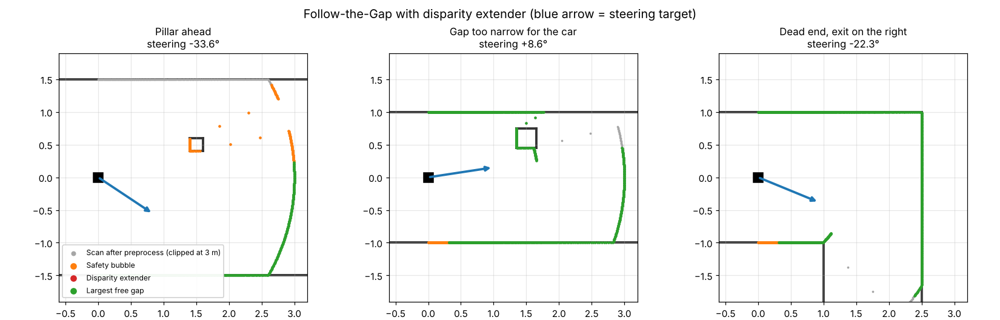

# RoboRacer LiDAR Planning — Gap Follow · Wall/Obstacle Clustering · Wall Follow

**2026 Automotive Engineering Lab, Team 2** project:
a 1/10-scale autonomous race car (RoboRacer / F1TENTH-style) that drives a closed-loop track **without a map**, reacting to each sensor frame.

- **Follow the Gap** with a disparity extender, for sections with obstacles
- **Wall / obstacle classification** by clustering each scan, used to switch modes
- **Wall following** (centre of two walls, PID), for the pipe-shaped sections

> The full team stack (ROS 2 Humble nodes, camera lane following, motor control, mode manager) lives in a private team repository.
> This repository contains only the LiDAR planning part assigned to me, as plain Python with no ROS dependency.

## Results



**Follow the Gap.** The scan is cleaned, the closest obstacle is wiped with a safety bubble, and every edge is widened by the car's half width so that gaps the car cannot fit through disappear. The car aims at the deepest point near the centre of the largest remaining gap. In the middle panel, the 0.25 m slit between the box and the wall is rejected and the car passes on the open side.


**Wall vs. obstacle.** Each scan is split into clusters of consecutive points with an adaptive breakpoint threshold. A cluster is an obstacle only if it is **short** and lies **inside the forward corridor**. The length check is what stops the outer wall of a corner from being mistaken for an obstacle (right panel).

**Tests.** All 112 tests pass (`python -m pytest`: 12 passed, 100 xpassed, 0 failed).
The two speed-selection functions (`speed_from_front`, `speed_from_steer`) belong to a teammate (hardware/control); this repository carries **temporary** implementations, marked `TODO`, so the controllers can be driven end to end until the teammate's version replaces them.


**Closed-loop check without ROS.** `sim/offline_sim.py` drives the controllers on a 1.2 m pipe-like loop with boxes, using a kinematic bicycle model and the same 0.24° / 20 Hz beam layout as the YDLIDAR TEA. Gap follow completes 3 laps with 3 cm range noise. This is a quick sanity check only; f1sim_ms and the real car are still required.

| Scenario (`--boxes`) | gap | wall |
|---|---|---|
| `none` (empty loop) | 3 laps, 44 s/lap | 3 laps, 42 s/lap |
| `alt` (3 boxes, alternating sides) | 3 laps, 49 s/lap (also with 3 cm noise) | 3 laps (boxes are passed by luck: wall follow has no avoidance; on the car the mode manager switches to GAP) |
| `wall` (box touching the wall) | 3 laps | 3 laps |
| `row` (2 boxes 1 m apart, opposite sides) | **crash** | crash |

The `row` case is a geometry limit, not a code bug: with wheelbase 0.25 m and `max_steer_deg` 20°, the minimum turning radius is about 0.69 m, too large for a 0.5 m sidestep within 1 m in a 1.2 m corridor. It passes with 30° steering or a 1.6 m corridor. The real maximum steering angle and box spacing need to be measured.

## Pipeline

```
/scan ─ normalize ─┬─ cluster_scan ─ find_obstacles ──────────────► mode switch (WALL ↔ GAP)
                   ├─ wall_distance ×2 ─ center_error ─ PID ───────► steering (wall follow)
                   └─ preprocess ─ safety_bubble ─ disparity_extend
                        ─ find_max_gap ─ best_point ───────────────► steering (gap follow)
```

Convention: REP-103 (x forward, y left, angle 0 straight ahead, counter-clockwise positive).

## What I implemented

| File | Function | Idea |
|---|---|---|
| `src/control/control/core/gap.py` | `preprocess` | Interpolate invalid beams (NaN/inf/≤0) from neighbours instead of treating them as obstacles, clip to max range, edge-padded moving average |
| | `safety_bubble` | Zero every beam within ±asin(R / r) of the closest point (±90° if r ≤ R) |
| | `disparity_extend` | At each range jump, copy the near distance d over the far side for atan(half_width / d); edges detected on the input, written to a copy |
| | `find_max_gap` | Longest run of free beams (ties keep the first) |
| | `best_point` | Among beams ≥ 0.9 × deepest, pick the one closest to the gap centre |
| `src/control/control/core/wall.py` | `wall_distance` | F1TENTH Lab 3 geometry: α = atan2(a·cosθ − b, a·sinθ), D = b·cosα + L·sinα; median over a small angular window to survive dropouts; reject far beams before the trigonometry (corner case) |
| | `center_error` | Error to the corridor centre, continuous when one wall disappears |
| | `PID` | Discrete PID with integral anti-windup and safe handling of dt ≤ 0 |
| `src/perception/perception/core/scan_utils.py` | `cluster_scan` | Adaptive breakpoint: split when the gap between consecutive valid points exceeds `break_dist + break_ratio × r` |
| | `find_obstacles` | Short cluster (≤ max length) with a point inside the forward corridor |

## Run it

```bash
pip install -r requirements.txt
python -m pytest                              # contract tests
python demo.py                                # regenerates the figures in docs/
python sim/offline_sim.py gap                 # closed loop, no ROS (Windows/macOS/Ubuntu)
python sim/offline_sim.py wall --boxes none --plot docs/offline_wall.png
```

With Ubuntu 22.04 and [f1sim_ms](https://github.com/leemyungsub324/f1sim_ms) installed (team TODO 4-0):

```bash
python3 sim/make_pipe_map.py maps/pipe --width 1.2   # then place boxes with f1sim_ms/tools/obstacle_map_maker.py
python3 sim/sim_check.py gap --render --map maps/pipe_obs
```

Parameters come from `config/params.yaml`, a copy of the team `safe.yaml` (`gap_follow`, `wall_follow`). Pass `--params <team repo>/src/bringup/config/safe.yaml` to use the team file directly.

## Status and next steps

- [x] Gap follow — unit tests pass
- [x] Wall / obstacle clustering — unit tests pass
- [x] Wall follow — unit tests pass
- [x] Closed-loop sanity check without ROS (`sim/offline_sim.py`)
- [ ] Port to the team repository (`lidar` branch, PR)
- [ ] Gap follow validated in the f1sim_ms simulator (3 collision-free laps on the box map)
- [ ] Mode switching WALL ↔ GAP in simulation, then on the real car (pipe section)
- [ ] Track measurements → parameters (corridor width, box size, car width, steering limit)
- [ ] Final track demo (Dec 17, 2026)

## Credits

- Project framework, interfaces, function specifications (docstrings) and contract tests: team lead, 2026 Automotive Engineering Lab Team 2.
- `normalize_scan`, `crop_fov`, `front_distance`, `follow_gap`, `follow_walls` and the synthetic scan generator `synth.py` were provided by the team lead.
- Implementation of the functions listed in **What I implemented**: Donghyun An ([@andong0620](https://github.com/andong0620)).
- Algorithms follow the F1TENTH course labs ([Lab 3 Wall Following](https://github.com/f1tenth/f1tenth_lab3_template), [Lab 4 Follow the Gap](https://github.com/f1tenth/f1tenth_lab4_template)).

---

### 요약
맵 없이 매 스캔만 보고 판단합니다. 장애물 구간은 gap follow로 피하고, 벽과 장애물은 클러스터링으로 구분하며, 파이프 구간은 양쪽 벽 중앙을 PID로 추종합니다.

